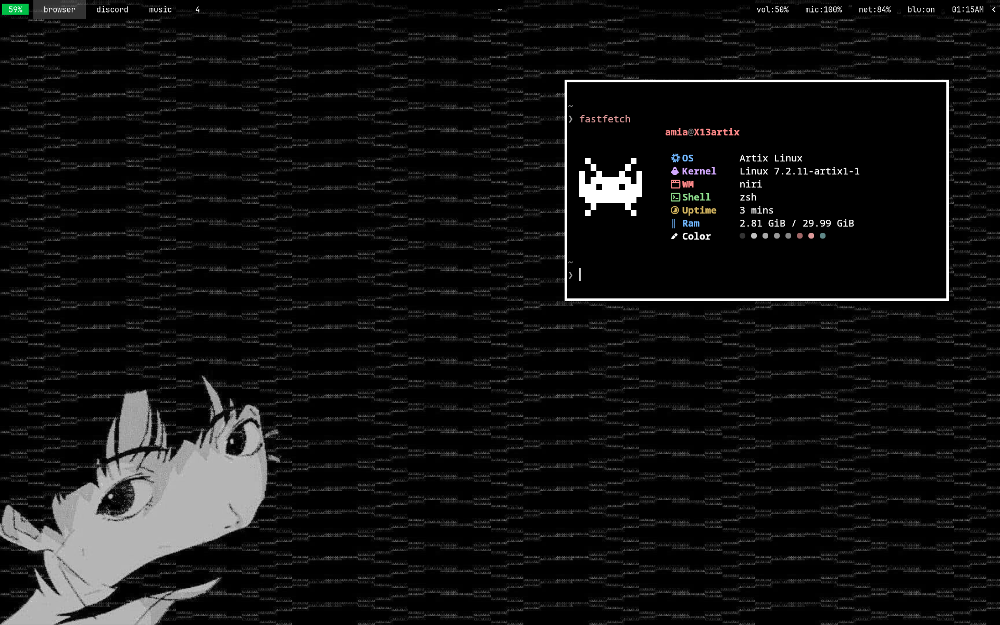

# thinkpad dotfiles
current dotfiles for my x13 gen 4

## showcase


## basic start
this example will be for artix, but should be easy to apply to anything else.
install paru/yay if you haven't already:

```bash
sudo pacman -S --needed git

git clone https://github.com/amiadx/thinkpad-dotfiles.git
cd thinkpad-dotfiles

# note, please review this package list! don't install stuff you don't need!
paru -S --needed - < packages.txt

stow -t ~ .
```
for any other non-arch based distro, please install everything in packages.txt.

spotify + spicetify + marketplace setup (not required):
```bash
spotify-launcher

# focus to spotify and log in before executing the following...
spicetify config spotify_path "$HOME/.local/share/spotify-launcher/install/usr/share/spotify"
spicetify config custom_apps marketplace

spicetify config current_theme text
spicetify config color_scheme PureBlack

spicetify backup apply
```
## description
hello! these are my current dotfiles that i use for my x13 gen 4.

my x13 gen 4 has the following specs:
- amd ryzen 5 pro 7540u
- amd radeon 740m graphics
- 32gb lpddr5x ram
- 1tb ssd
- 1920x1200 ips matte panel

## items provided
here are the main items that have provided configs:
- equibop (vesktop with extra plugins)
- fastfetch (neofetch but faster)
- hyprlock (customizable lockscreen)
- mako (notification daemon)
- niri (scrolling window manager)
- rofi (app opener)
- spicetify (spotify customization)
- starship (shell prompt)
- wallpapers (lain wallpaper)
- waybar (status bar)

## credits / transparency
- equibop theme based off of [system24 by refact0r](https://github.com/refact0r/system24)
- spicetify theme based off of [text by the spicetify team](https://github.com/spicetify/spicetify-themes/tree/master/text)
- waybar config based off of [kamlendras's config](https://github.com/kamlendras/waybar-macos-sequoia/tree/259ecb4b5a65a52ece0708fb4c65db4f57268329)
- fastfetch config is [meetthehorizon's config](https://github.com/fastfetch-cli/fastfetch/discussions/971#discussioncomment-17703671)
- rofi config is ai generated by gemini
